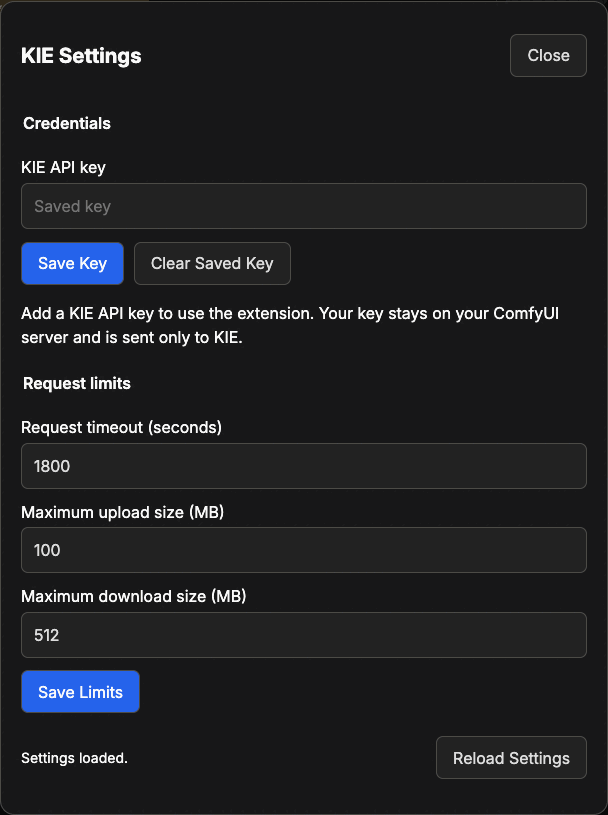

# ComfyUI KIE Advanced Guide

## Contents

- [What each node sends](#what-each-node-sends)
- [Keys and access](#keys-and-access)
- [Settings](#settings)
- [Models](#models)
- [Chat models](#chat-models)
- [Files and uploads](#files-and-uploads)
- [Caching and reruns](#caching-and-reruns)
- [Recover a task](#recover-a-task)
- [When a node stops](#when-a-node-stops)
- [Update or remove](#update-or-remove)
- [Development](#development)
- [Troubleshooting](#troubleshooting)

## What each node sends

**Image: Generate**, **Video: Generate**, and **Audio: Generate** first read
the model from KIE: its catalog entry and its input schema, free, once per model
while ComfyUI runs. They upload your images as lossless WebP, your masks as PNG,
your audio as WAV, and your video as MP4 to the upload host of KIE.

Each creates one task. The task holds `prompt`, the other text boxes, the named
settings you set, the inputs in `arguments`, and the files from **File:
Add**, each under the name the model uses. The node records the task as soon as
KIE accepts it, and reads its state every three seconds until it ends. Then the
node downloads the files the task made, and returns them with the link of each
file in `files` and the whole result from KIE in `result`.

The other nodes:

- **Chat: Ask** reads the model the same way. It sends the documents, the
  images, and the question in one request, in the format of the model. It returns
  the answer, the reasoning the model shows, and the conversation.
- **Chat: Attach Document** reads a PDF or text file from the input folder of
  ComfyUI. It sends nothing.
- **File: Add** names the model input a file goes to and adds the file: a
  link, an image, a mask, audio, video, or the files of another KIE node. It
  sends nothing; the job node uploads what it holds.
- **Task: Download** reads the state of one recorded task and downloads its
  files. State reads and downloads are free.
- **Model: Info** reads one model from KIE and returns every input it takes,
  as JSON. It is free.

Every task and every chat request goes out once. Files KIE makes download
without the key.

## Keys and access

Save the key in **KIE Settings**: in the ComfyUI menu, open **Extensions**,
then **KIE**, then **KIE Settings**. The key
stays in a private folder, and the first request that uses it checks it.
`KIE_API_KEY`, set where ComfyUI starts, comes first. The key goes only to the
hosts of KIE.

The key and the settings change only over a direct local connection to the
ComfyUI server. For remote access, a reverse proxy, or multi-user mode, set
`KIE_API_KEY` instead.

The private folder is:

| System  | Folder                                        |
| ------- | --------------------------------------------- |
| macOS   | `~/Library/Application Support/KIEComfyUI`    |
| Linux   | `${XDG_STATE_HOME:-~/.local/state}/kie-comfy` |
| Windows | `%LOCALAPPDATA%\KIEComfyUI`                   |

To use another folder, set `KIE_COMFY_STATE_DIRECTORY` to an absolute path
outside the folders of the extension and of ComfyUI. The files are not
encrypted, and only your user can read them.

## Settings

Change these in **KIE Settings**. New requests use the saved values.



| Setting                        | Default | Range      | What it limits                                                        |
| ------------------------------ | ------- | ---------- | --------------------------------------------------------------------- |
| **Request timeout (seconds)**  | 1800    | 10 to 3600 | How long one request may take, and the whole wait for a task.         |
| **Maximum upload size (MB)**   | 100     | 1 to 100   | Each image, mask, audio clip, video, or document the extension sends. |
| **Maximum download size (MB)** | 512     | 16 to 4096 | The largest reply or output file the extension accepts.               |

## Models

Each job node runs any KIE model of its kind. Type the model ID in `model`,
such as `wan/3-0-video`. The default is the starting model of the node:

| Node            | Runs models that make | Default model                          |
| --------------- | --------------------- | -------------------------------------- |
| Image: Generate | Images                | `gpt-image-2-5-sunburst-text-to-image` |
| Video: Generate | Video                 | `wan/3-0-video`                        |
| Audio: Generate | Audio                 | `elevenlabs/text-to-speech-turbo-2-5`  |
| Chat: Ask       | Chat replies          | `gpt-6-luna`                           |

The kind of a model comes from the task types KIE lists for it, so an
upscaler and a background remover run in **Image: Generate**.

The named settings are the inputs most models of a kind share:

| Node            | Named settings                                                                                                   |
| --------------- | ---------------------------------------------------------------------------------------------------------------- |
| Image: Generate | `aspect_ratio`, `resolution`, `output_format`, `num_images`, `guidance_scale`, `num_inference_steps`, and `seed` |
| Video: Generate | `resolution`, `aspect_ratio`, `generate_audio`, `duration`, and `seed`                                           |
| Audio: Generate | `output_format` and `seed`, with `voice` and `text` as text inputs                                               |

A text setting is one line that sends nothing while empty. An on/off setting
is `default`, `true`, or `false`, and a number setting is `default`, or
`custom` with a value; `default` sends nothing.

A setting you set goes under its own name, and only a model with an input of
that name takes it. A number goes as text to an input that takes only text, such as a duration KIE lists as
`"5"`. A model that names a setting another way, such as `size`, takes it in
`arguments`, under its own name. Every value is the model's to check: KIE
checks it when it creates the task, and a refused task bills nothing.

`arguments` is a JSON object of the other inputs of the model, under the names
the model uses, such as `{"audio": false}`. Inputs you leave out keep the
defaults of the model. A default is sometimes the most expensive choice, such
as 1080P on Wan 3.0. **Model: Info** lists every input, its choices, and its
default.

## Chat models

KIE serves its chat models in four request formats, and the schema of each
model names its format. GPT uses OpenAI Responses, Claude uses Anthropic
Messages, and Gemini uses native Gemini or Chat Completions. **Chat: Ask**
writes the question in that format: the system prompt, the earlier turns, the
documents, the images, then the prompt.

KIE drops `temperature`, `top_p`, `top_k`, and the token limits on every
format, so the node offers none of them. It takes only what KIE honors:

| Input              | GPT                                             | Claude | Gemini        |
| ------------------ | ----------------------------------------------- | ------ | ------------- |
| `reasoning_effort` | `none`, `low`, `medium`, `high`, `xhigh`, `max` | none   | `low`, `high` |
| `json_schema`      | Yes, as the `json_schema` text format           | No     | No            |
| PDF documents      | Yes                                             | No     | No            |
| Text documents     | Yes                                             | Yes    | Yes           |
| `system_prompt`    | Yes                                             | Yes    | Yes           |

`extra_fields` adds other fields to the request as written, in the format of
the model. The node refuses a field it sets itself.

## Files and uploads

Give a model a file with **File: Add**. Set `field` to the file input of the
model, under its own name, such as `image_urls` or `reference_audio_urls`, and
connect the file to `file`, or type a link into it. `file` takes:

- A link.
- `files` from another KIE node. The link goes on as it is, with no upload.
- An image, mask, audio clip, or video from a ComfyUI node. The job node
  uploads it to KIE first.

Chain **File: Add** nodes for several files, and connect the last `files` to
the `files` input of the job node. Files for the same input keep the order of
the chain. An input that takes a list always gets a list, even with one file.

Uploads go to the upload host of KIE, and KIE deletes them after 24 hours. The
files a task makes stay on KIE for 14 days. Anyone with a link can open its
file.

## Caching and reruns

- Change `run_number` to send the same request again. ComfyUI reuses the last
  result of a node while none of its inputs change.
- Unless you set `seed` to `custom`, the model picks a new seed for each task.
- Saving a different key starts over with no cached results; changing the
  settings does not.
- Each request uploads its own local files, so a rerun uploads them again. A
  link from the `files` of another node goes as it is, with no upload.

## Recover a task

Every job node records each task as soon as KIE accepts it. KIE has no
cancel: the task keeps running, and KIE bills it, after a cancel in ComfyUI,
after a restart, and when the request timeout passes. Collect it with **Task:
Download**, and press R to list tasks recorded later. A task leaves the list
once its files download, when KIE has dropped it, or after 14 days.

## When a node stops

Job nodes check these before they upload or send anything. A job node stops
when:

- `model` is empty, KIE has no model with that ID, the model makes another
  kind of output, or KIE has not published its input schema yet.
- You set a text box or a named setting, and the model has no input of that
  name, or `arguments` sets the same input too.
- `arguments` is not a JSON object, or names an input the model does not take.
  KIE ignores such an input and still bills the task.
- **File: Add** names an input the model does not take, one that takes no
  file, or one that `arguments` also sets.
- An input that takes one file gets several, or a list holds more files than
  the model takes.
- A required input has nothing, and the schema of the model gives it no
  default.
- A file is over the upload limit.

**Chat: Ask** stops when `prompt` is empty, or when it sets a
`reasoning_effort`, a `json_schema`, or a PDF that the format of the model
does not take. **File: Add** stops when `field` is empty or holds more than a
name, when no link reaches `file` and it is empty, or when `file` is not an
`https://` link. **Task: Download** stops when the chosen task has no record
on this computer. **Model: Info** stops when `model` is empty or KIE has no
model with that ID.

## Update or remove

To update, replace the `custom_nodes/kie` folder, and restart ComfyUI. Open
the updated examples in a new tab.

To remove the extension, move the folder out of `custom_nodes`, and restart.
The [private folder](#keys-and-access) stays; delete it to remove the saved
key, the settings, and the task records.

## Development

Development needs mise. `.mise.local.toml` names the ComfyUI install that the
type checker and the schema export read:

```toml
[env]
COMFYUI_PATH = "/path/to/ComfyUI"
COMFYUI_PYTHON = "/path/to/ComfyUI/.venv/bin/python"
```

`mise run setup` installs the tools, the locked dependencies, the gspot tools,
and the Git hooks, and `mise run deps` puts the ComfyUI install on the path of
the project environment.

gspot runs every check, and the Git hooks run it on each commit and push:

```shell
bun run --no-install gspot check
bun run --no-install gspot check --fix
```

`AGENTS.md` lists the rules gspot installs. Change the settings in
`gspot.toml` only with `gspot set`, `add`, `remove`, `ignore`, and `unignore`.

| Change               | Then run                                  |
| -------------------- | ----------------------------------------- |
| Python code          | Restart ComfyUI.                          |
| `web/scripts/`       | `bun run build`, and commit both outputs. |
| A node or a workflow | `mise run workflows`.                     |

The hooks check that the examples match their descriptions, that every node
has a help page naming its real inputs, and that the built browser files match
`web/scripts/`.

The import rules in `gspot.toml` keep the packages in layers: `src/config`
imports nothing, `src/state` only `config`, and only `src/comfy` and
`src/nodes` import the modules of ComfyUI.

## Troubleshooting

Each message of the extension names the next step. The ones below say more.

### KIE refused the API key

Check the key at [kie.ai/api-key](https://kie.ai/api-key), then save it again
in **KIE Settings**. A key set in `KIE_API_KEY` comes first; clear that
variable to use the saved key.

### Your KIE account has too few credits

Add credits at [kie.ai/billing](https://kie.ai/billing). A task that failed
bills nothing.

### KIE has no model with this ID

Copy the ID from the page of the model on [kie.ai/market](https://kie.ai/market).
**Model: Info** shows whether KIE has published its input schema.

### The model has no input named this

Empty the named setting or set it to `default`, and put the value in
`arguments` under the name the model uses. **Model: Info** lists its inputs.

### KIE is limiting requests

Wait a moment before you run again. KIE reads models at one request a second
for each account, and the extension waits between its own reads.

### A video never arrives

The task may still run on KIE. Collect it with **Task: Download**. If the
task failed, KIE billed nothing, and the message gives the reason.
