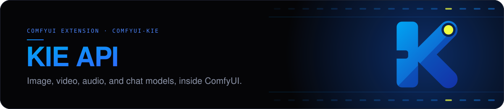

# 

[](#requirements)
[](#requirements)
[](#requirements)
[](LICENSE.md)

Run KIE models in ComfyUI with your own API key: images, video, audio, and chat.

## Requirements

- Python 3.12 or later.
- ComfyUI 0.37.2 or later, with frontend 1.52.7 or later.
- A KIE API key, from [kie.ai/api-key](https://kie.ai/api-key).

Generation uses your provider account and can incur charges.

## Install

Stop ComfyUI. From its `custom_nodes` folder, clone the extension:

```sh
git clone https://github.com/stefanionescu/comfyui-kie.git kie
```

In Comfy Desktop, use **Manage > About > Location** to find the installation's
`ComfyUI` folder. Its **Terminal** opens that instance's Python environment.

Restart ComfyUI and reload its window. A supported ComfyUI installation supplies the packages this extension needs.

## First run

1. Open **Extensions > KIE > KIE Settings** from the ComfyUI menu and save
   your KIE API key.
2. Open **Browse Templates > kie > image-01-design-a-host**.
   Read **Start Here** and edit the description.
3. Select **Run**. **Design** creates the portrait; **Turn** makes the host wave.
   This example sends two paid image requests.

KIE cannot cancel an accepted task. Cancelling in ComfyUI stops the wait while
the task continues and can incur charges. Use **Task: Download** to collect it.

Change `run_number` to run again with unchanged inputs. For remote or multi-user
setups, see the [access instructions](ADVANCED.md#keys-and-access).

## Example workflows

Open these from **Browse Templates > kie**, or load their JSON files.
Read **Start Here** before running. After an update, open examples in a new tab.

| Workflow                                                                                          | Input                      |
| ------------------------------------------------------------------------------------------------- | -------------------------- |
| [Image: Design a Host](example_workflows/image-01-design-a-host.json)                             | A host description         |
| [Image: Cut Out a Product](example_workflows/image-02-cut-out-a-product.json)                     | A product description      |
| [Image: Make a Poster Series](example_workflows/image-03-make-a-poster-series.json)               | A brief                    |
| [Audio: Voice a Script](example_workflows/audio-01-voice-a-script.json)                           | A script                   |
| [Audio: Write a Song](example_workflows/audio-02-write-a-song.json)                               | A song description         |
| [Video: Animate a Photo](example_workflows/video-01-animate-a-photo.json)                         | A host description         |
| [Video: Show a Product with a Voice](example_workflows/video-02-show-a-product-with-a-voice.json) | A product and a line       |
| [Video: Recover a Video](example_workflows/video-03-recover-a-video.json)                         | A task left running        |
| [Chat: Write a Product Listing](example_workflows/chat-01-write-a-product-listing.json)           | A product photo and a spec |
| [Chat: Write a Host Script](example_workflows/chat-02-write-a-host-script.json)                   | A product photo            |

## Nodes

Find the nodes under **KIE**. Each linked help page explains its inputs,
outputs, and usage.

| Node                                                       | What it does                                                                               | Paid |
| ---------------------------------------------------------- | ------------------------------------------------------------------------------------------ | ---- |
| [Image: Generate](web/docs/KIEImageGenerate.md)            | Runs supported KIE image models: generating, editing, upscaling, and removing backgrounds. | Yes  |
| [Video: Generate](web/docs/KIEVideoGenerate.md)            | Runs supported KIE video models, from text, a first frame, or references.                  | Yes  |
| [Audio: Generate](web/docs/KIEAudioGenerate.md)            | Runs supported KIE audio models: speech, music, and sound.                                 | Yes  |
| [Chat: Ask](web/docs/KIEChatAsk.md)                        | Asks a KIE chat model, with images or documents, and keeps the conversation.               | Yes  |
| [Chat: Attach Document](web/docs/KIEChatAttachDocument.md) | Attaches a PDF or text file to **Chat: Ask**.                                              | No   |
| [File: Add](web/docs/KIEFileAdd.md)                        | Names the model input that each image, video, audio clip, or link goes to.                 | No   |
| [Task: Download](web/docs/KIETaskDownload.md)              | Collects a task that ran on KIE, such as one after a cancel.                               | No   |
| [Model: Info](web/docs/KIEModelInfo.md)                    | Shows the inputs any KIE model takes, as JSON.                                             | No   |

Use the ID from [KIE's model catalog](https://kie.ai/market) in `model`.
KIE must publish an input schema, and the node must support the output kind.
**Model: Info** lists the model's inputs and defaults.
See [models and arguments](ADVANCED.md#models).

## Troubleshooting

| Problem                        | What to check                                                                  |
| ------------------------------ | ------------------------------------------------------------------------------ |
| Nodes or templates are missing | Install the complete extension, then restart ComfyUI and reload its window.    |
| The key is rejected            | Check the saved key and any `KIE_API_KEY` environment value.                   |
| A model or input is rejected   | Check its exact ID and published inputs with **Model: Info**.                  |
| A video has not arrived        | Collect the recorded task with **Task: Download**.                             |
| Settings cannot be changed     | Use a direct local connection, or configure credentials on the ComfyUI server. |

See the [advanced guide](ADVANCED.md#troubleshooting) for request errors and recovery.

[Advanced guide](ADVANCED.md) · [MIT license](LICENSE.md)
