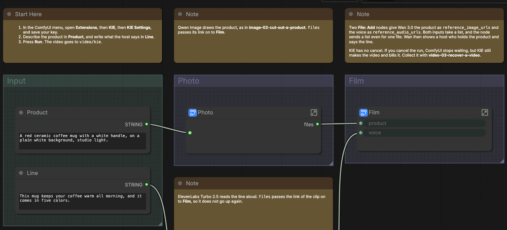
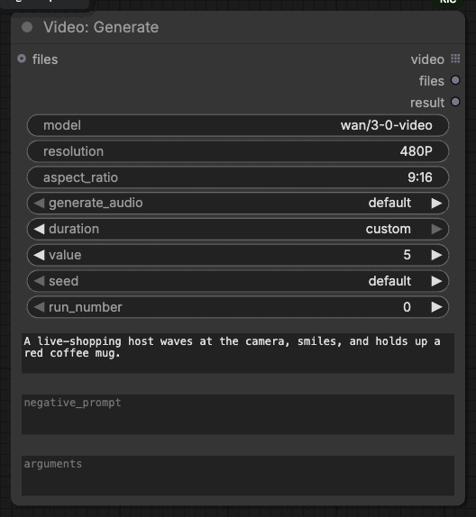

# 

[](#requirements)
[](#requirements)
[](#requirements)
[](LICENSE.md)

Run any KIE model in ComfyUI with your own API key: images, video, audio, and chat.

## Contents

- [Requirements](#requirements)
- [Install](#install)
- [First run](#first-run)
- [Example workflows](#example-workflows)
- [Nodes](#nodes)
- [Models](#models)
- [How a run works](#how-a-run-works)
- [Development](#development)
- [Common problems](#common-problems)
- [License](#license)

## Requirements

- Python 3.12 or later.
- ComfyUI 0.37.2 or later, with frontend 1.52.7 or later.
- A KIE API key, from [kie.ai/api-key](https://kie.ai/api-key).

## Install

Put the extension in `ComfyUI/custom_nodes/kie`, and restart ComfyUI. It needs
no packages besides the ones ComfyUI already has.

In Comfy Desktop, select the **⋮** icon on the instance card, then **Manage**.
Under **About**, copy **Location**. In that folder, find the `ComfyUI` folder
that holds `main.py`, and put the extension in its `custom_nodes` folder.

To update the extension, replace the folder, then restart ComfyUI. To remove it,
delete the folder; the [advanced guide](ADVANCED.md#update-or-remove) says
where the key and the task records stay.

## First run

1. In the ComfyUI menu, open **Extensions**, then **KIE**, then **KIE
   Settings**, and save your KIE API key.
2. Open **Browse Templates**, choose **kie**, then
   **image-01-design-a-host**, and select **Run**.
3. **Design** shows your host, and **Turn** shows the same host waving.

To send the same request again, change `run_number`.

## Example workflows

| Workflow                                                                                          | Input                      |
| ------------------------------------------------------------------------------------------------- | -------------------------- |
| [Image: Design a Host](example_workflows/image-01-design-a-host.json)                             | A host description         |
| [Image: Cut Out a Product](example_workflows/image-02-cut-out-a-product.json)                     | A product description      |
| [Image: Make a Poster Series](example_workflows/image-03-make-a-poster-series.json)               | A brief                    |
| [Audio: Voice a Script](example_workflows/audio-01-voice-a-script.json)                           | A script                   |
| [Audio: Write a Song](example_workflows/audio-02-write-a-song.json)                               | A song description         |
| [Video: Animate a Photo](example_workflows/video-01-animate-a-photo.json)                         | A host description         |
| [Video: Show a Product with a Voice](example_workflows/video-02-show-a-product-with-a-voice.json) | A product and a line       |
| [Video: Recover a Video](example_workflows/video-03-recover-a-video.json)                         | A task left running        |
| [Chat: Write a Product Listing](example_workflows/chat-01-write-a-product-listing.json)           | A product photo and a spec |
| [Chat: Write a Host Script](example_workflows/chat-02-write-a-host-script.json)                   | A product photo            |

They are in **Browse Templates**, under **kie**. Start with the **Start Here** note of
each workflow. Most steps are subgraphs. Media inputs start empty, and most
workflows make their own inputs with KIE models.



After an update, open the examples in a new tab to get the new versions.

## Nodes

The nodes are under **KIE** in the node menu, and each has a help page.


| Node                                                       | What it does                                                                        | Paid |
| ---------------------------------------------------------- | ----------------------------------------------------------------------------------- | ---- |
| [Image: Generate](web/docs/KIEImageGenerate.md)            | Runs any KIE image model: generating, editing, upscaling, and removing backgrounds. | Yes  |
| [Video: Generate](web/docs/KIEVideoGenerate.md)            | Runs any KIE video model, from text, a first frame, or references.                  | Yes  |
| [Audio: Generate](web/docs/KIEAudioGenerate.md)            | Runs any KIE audio model: speech, music, and sound.                                 | Yes  |
| [Chat: Ask](web/docs/KIEChatAsk.md)                        | Asks any KIE chat model, with images or documents, and keeps the conversation.      | Yes  |
| [Chat: Attach Document](web/docs/KIEChatAttachDocument.md) | Attaches a PDF or text file to **Chat: Ask**.                                       | No   |
| [File: Add](web/docs/KIEFileAdd.md)                        | Names the model input that each image, video, audio clip, or link goes to.          | No   |
| [Task: Download](web/docs/KIETaskDownload.md)              | Collects a task that ran on KIE, such as one after a cancel.                        | No   |
| [Model: Info](web/docs/KIEModelInfo.md)                    | Shows the inputs any KIE model takes, as JSON.                                      | No   |

## Models

Each job node runs any KIE model of its kind, and **Chat: Ask** asks any KIE
chat model. Type the model ID in `model`, such as `wan/3-0-video`. The page of
each model on [kie.ai/market](https://kie.ai/market) shows its ID.



Each job node has its own inputs for the settings most models of a kind share,
such as `aspect_ratio`, `seed`, and `num_images`. A text setting sends nothing
while empty, and an on/off or number setting sends nothing at `default`. A
number setting at `custom` sends the value you set. Write any other input in
`arguments` as JSON, under the name the model uses, such as `{"audio": false}`.
**Model: Info** lists every input a model takes, and bills nothing.

Before it pays, the node reads the model from KIE. It stops when KIE has no such
model, the model makes another kind of output, or the model has no input you
set. The [advanced guide](ADVANCED.md#models) lists the checks.

## How a run works

1. The node reads the model from KIE and checks your inputs against it. It
   stops before it pays.
2. The node uploads your images, audio, and video to KIE, creates one task
   with your key, records it, and waits. Nothing goes twice.
3. Outputs also carry the link of each file, so the next node sends that link
   instead of uploading the file again. Nodes connected to an empty output are
   skipped.

KIE has no cancel. A cancel in ComfyUI stops the wait, but KIE still runs the
task and bills it, and **Task: Download** collects it later. The
[advanced guide](ADVANCED.md#what-each-node-sends) lists what each node sends
and returns.

## Development

Development needs mise. Point the checks at ComfyUI in `.mise.local.toml`:

```toml
[env]
COMFYUI_PATH = "/path/to/ComfyUI"
COMFYUI_PYTHON = "/path/to/ComfyUI/.venv/bin/python"
```

Install the tools, the dependencies, and the Git hooks, then run every check:

```shell
mise trust
mise run setup
bun run --no-install gspot check
```

The hooks run the same checks on each commit and push. Restart ComfyUI after a
change in Python. After a change in the browser code, run `bun run build`;
after a change in a workflow description, run `mise run workflows`. The
[advanced guide](ADVANCED.md#development) says more.

## Common problems

| Problem                               | Fix                                                                                                                     |
| ------------------------------------- | ----------------------------------------------------------------------------------------------------------------------- |
| No KIE nodes in the menu              | Check that the folder is `ComfyUI/custom_nodes/kie`, ComfyUI is 0.37.2 or later, and the console shows no import error. |
| No **KIE** entry under **Extensions** | Check that `web/extension.js` is in the folder of the extension, then reload the window.                                |
| The settings cannot change            | ComfyUI runs in multi-user mode, or opens from another computer. Set `KIE_API_KEY` where ComfyUI starts instead.        |
| Node help is missing                  | Reinstall the whole extension, including `web/docs`.                                                                    |
| The templates are missing             | Reinstall the whole extension, including `example_workflows`.                                                           |
| A video never arrives                 | Collect it with **Task: Download**; KIE keeps a finished task for 14 days.                                              |

More in the [troubleshooting part of the advanced guide](ADVANCED.md#troubleshooting).

## License

[MIT](LICENSE.md).
