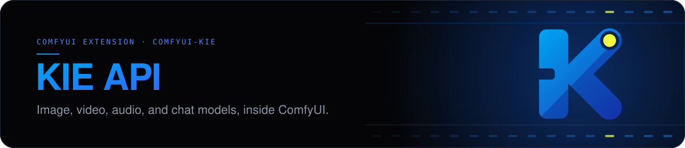

# 

Run any KIE model in ComfyUI with your own API key.

## Contents

- [Requirements](#requirements)
- [Nodes](#nodes)
- [License](#license)

## Requirements

- Python 3.12 or later.
- ComfyUI 0.37.2 or later, with frontend 1.52.7 or later.
- A KIE API key.

## Nodes

| Node                                                       | What it does                                                                        | Paid |
| ---------------------------------------------------------- | ----------------------------------------------------------------------------------- | ---- |
| [Image: Generate](web/docs/KIEImageGenerate.md)            | Runs any KIE image model: generating, editing, upscaling, and removing backgrounds. | Yes  |
| [Video: Generate](web/docs/KIEVideoGenerate.md)            | Runs any KIE video model, from text, a first frame, or references.                  | Yes  |
| [Audio: Generate](web/docs/KIEAudioGenerate.md)            | Runs any KIE audio model: speech, music, and sound.                                 | Yes  |
| [Chat: Ask](web/docs/KIEChatAsk.md)                        | Asks any KIE chat model, with images or documents, and keeps the conversation.      | Yes  |
| [Chat: Attach Document](web/docs/KIEChatAttachDocument.md) | Attaches a PDF or text file to **Chat: Ask**.                                       | No   |
| [File: Add](web/docs/KIEFileAdd.md)                        | Names the model input that each image, video, audio clip, or link goes to.          | No   |
| [Task: Download](web/docs/KIETaskDownload.md)              | Collects a task that ran on KIE, such as one after a cancel.                        | No   |
| [Model: Info](web/docs/KIEModelInfo.md)                    | Shows the inputs any KIE model takes, as JSON.                                      | No   |

## License

MIT. See [LICENSE.md](LICENSE.md).
